# Registro de uso de IA

## Instrucciones del proyecto en Claude

Se armó un proyecto en Calude con las siguientes instrucciones:

### CONTEXTO

Estoy realizando un curso full stack. Mi intecion es aprender a programar

### OBJETIVO

El objetivo de este proyecto es actuar como un guia-acompanante-tutor para un curso de programacion full stack. Tu rol es siempre dar soluciones simples y explicarlas para que yo pueda incorporar los conceptos y comprenderlos. Mi objetivo es llegar a realizar todo al final del curso sin necesidad de acudir a la IA.

### INSTRUCCIONES

- Priorizar siempre simpleza de codigo para facilitar aprendizaje
- Explicar simpelmente (en criollo) como funciona cada parte de codigo que me pases.
- Asegurar que las correciones de codigo respeten lo mas posible la logica que voy construyendo (aunque no sea la mejor), porque la idea es ir mejorando mi pensamiento logico.
- Asegurate siempre guiarme con buenas practicas

### RESTRICCIONES

- Evitar codigo complejo innecesario
- No entregar porciones grandes de codigo
- No entregar codigo sin explicar
- No modificar estructura planteada por mi, a no ser que sea un error

### DOCUMENTACIÓN

- Al final de cada sesion pasame un resumen muy breve de cada pedido que realicé y de tu respuesta. El registro debe ser de la totalidad de la conversación y debe ser ultra breve!!!

Formato del registro:

```
Sesión [FECHA]
P: Consulta por sitios web de paletas cromáticas
R: Descripción y links a sitios
P: Centrar flex horizontal y vertical
R: Codigo + explicación
```

Cuando itero pedidos sobre un mismo tema/codigo para llegar a mi objetivo, registrar esa iteracion de manera muy breve.

---

## REGISTRO

### Sesión 04/10/2026 (mañana) 

> **P:** Consulta por sitios web de generadores de paletas aleatorias de 6, 8 o 9 colores y cómo funcionan
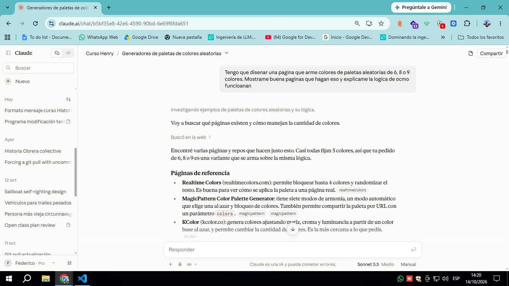
**R:** Búsqueda con links a Realtime Colors, MagicPattern, KColor y otros. Lógica: sorteo en HSL (no RGB), reglas de armonía sobre el matiz, bloqueo con arreglo de estados y cantidad como parámetro N. Se acordó empezar con HSL, una regla de armonía y bloqueo.

> **P:** Armar el home estático con una franja de 9 colores de borde a borde (HTML + CSS)

**R:** Errores detectados: 100%vw y 33%vw inválidos, y el h2 dentro del contenedor flex. Se propuso 9 div en el HTML, flex: 1 en cada uno y altura en vh. El JS generaría las franjas más adelante.

> **P:** Diferencia entre vh y vw, y por qué aparece la opción de crear un Word debajo de cada respuesta
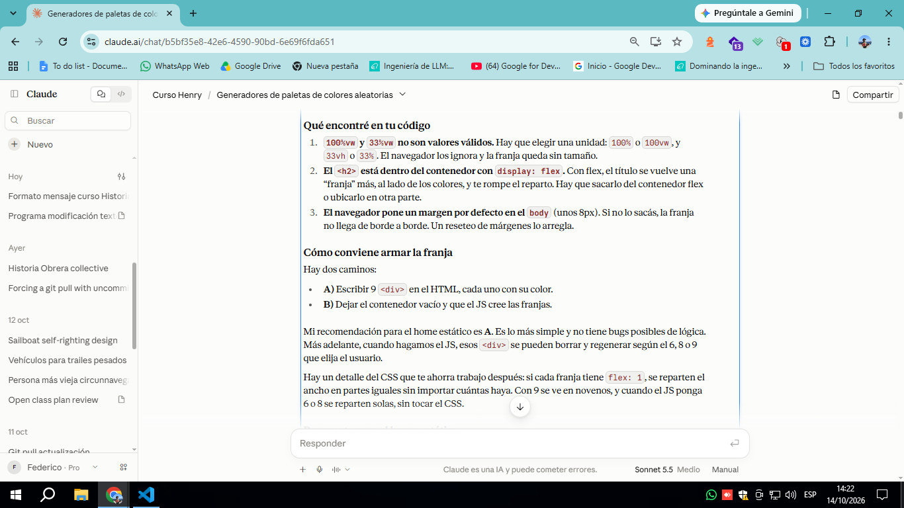
**R:** vw es el 1% del ancho de la ventana y vh el 1% del alto. Para el ancho se recomendó 100%, porque 100vw incluye la barra de scroll. El Word es una función de la interfaz que yo no genero, y se indicó revisar la configuración de creación de archivos.

> **P:** Explicación de flex: 1

**R:** Abreviatura de flex-grow: 1, flex-shrink: 1 y flex-basis: 0. Con todos los hijos en flex: 1, el espacio se reparte en partes iguales sin importar la cantidad. Eso permite pasar de 9 a 6 u 8 franjas sin tocar el CSS.

> **P:** Mostrar el código HSL debajo de cada color
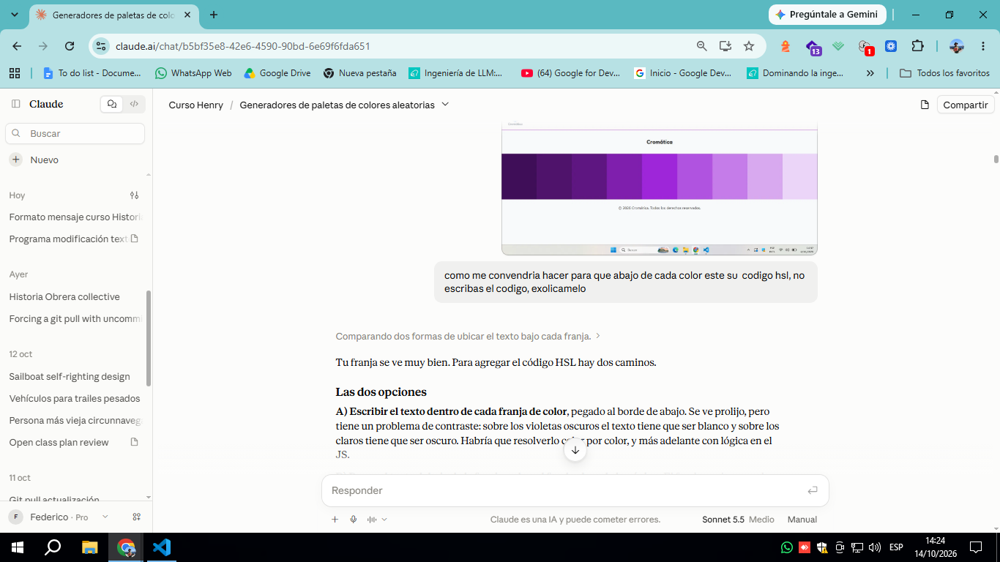
**R:** Se compararon dos caminos: texto sobre el color (problema de contraste) o debajo de la franja. Se eligió debajo, con cada columna formada por un bloque de color más su texto, y la altura en vh aplicada al bloque.

> **P:** "Colorfly Studio" no queda centrado en el navbar (probé text-align y position: relative)

**R:** text-align centra dentro de la caja del párrafo, y el space-between no centra el elemento del medio si los costados miden distinto. Solución: grid con grid-template-columns: 1fr auto 1fr y justify-self: end en los links. Se verificó con el HTML que el nav tiene exactamente tres hijos directos.

> **P:** Revisión de HTML/CSS de la franja con textos HSL (4 iteraciones)

**R:** 1ª: estructura correcta, pero el CSS era de la versión anterior. 2ª: la franja no llegaba al borde por flex: 1fr (la fr no existe en flex). 3ª: display: flex en .color ponía el texto al lado del bloque, y quedaban reglas viejas. 4ª: font-size: 0,5rem con coma, var(--color-negro) inexistente y fuente Nunito Sans mal escrita.

> **P:** Selector que agarre todas las clases que empiezan con "c"

**R:** Existe ([class^="c"]), pero también atrapa colors y colors-container, y falla si el elemento tiene varias clases. Se recomendó una clase compartida .c más c1 a c9 solo para el color.

> **P:** El botón "Generar paleta" no se ve en la página

**R:** Causa: main { display: flex }, pensada para el index, ponía el botón al lado de la franja de 100vw y lo empujaba fuera de pantalla. Se propuso mover el botón dentro del div contenedor para que todo se apile hacia abajo, sin afectar la portada.

> **P:** Cómo hacer un desplegable para elegir 6, 8 o 9, y pedido del código básico
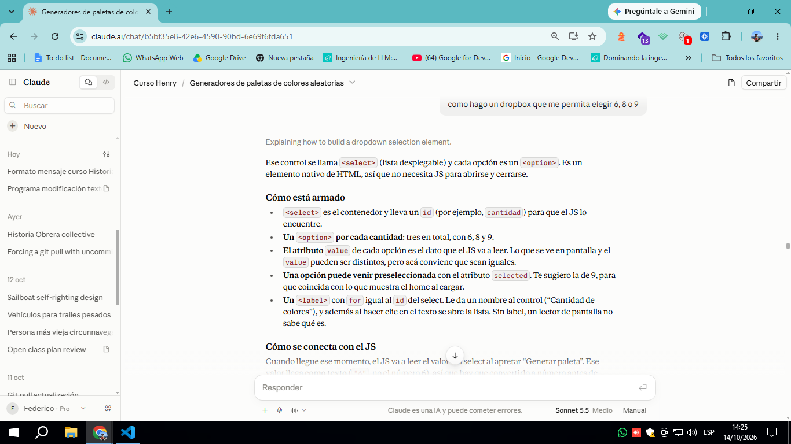
**R:** Se explicó &lt;select&gt; con un &lt;option&gt; por cantidad y value como dato que lee el JS. Se entregó el código con el 9 preseleccionado (selected) y agrupado en un div.controles. Aviso: el valor llega al JS como texto, hay que convertirlo a número.

> **P:** Para qué sirven label y for

**R:** for debe coincidir con el id del control. Da accesibilidad (lectores de pantalla) y agranda la zona de clic. Alternativa: envolver el select con el label, pero se prefirió for porque el id hace falta igual para el JS.

> **P:** Dos elementos hijos de un flex, uno de 1/3 y otro de 2/3

**R:** flex: 1 y flex: 2. Se aclaró que la abreviatura (con flex-basis: 0) es la que da el reparto exacto. Casos que lo rompen: contenido ancho (se corrige con min-width: 0) y gap o márgenes, que se descuentan antes de repartir. Alternativa: grid con 1fr 2fr.

> **P:** Documento de uso de IA (4 versiones)

**R:** 1ª: versión genérica con tabla de decisiones, que no seguía tu formato. 2ª: al corregirlo, registro en formato P:/R:. 3ª: ajuste a las instrucciones actualizadas del proyecto (ultra breve). 4ª: reescritura de la sección de documentación para un tono sintético pero más detallado, y este registro.

> **P:** Error de git push rechazado (el remoto tiene trabajo que no está en local)

**R:** Git frenó para no pisar cambios de GitHub. Se explicó git fetch, git diff main origin/main y --stat. Se encontró .github/workflows/static.yml, creado al activar GitHub Pages, y diferencias en styles.css, index.html y script.js. Se corrigió una afirmación mía previa: había dicho que solo era el static.yml.

> **P:** Traer solo el archivo de Pages a mi copia local y forzar el push

**R:** Pasos: git status, git checkout origin/main -- .github/workflows/static.yml, commit y git push --force origin main. Aviso de que se pierden los cambios de GitHub (excepto el workflow) y de que la página publicada puede dar 404 porque el index.html está en Desarrollo/.

---

### Sesión 04/10/2026 (tarde)

> **P:** Guía, sin código, para armar la lógica de "generar": animación sutil, franjas con el código debajo de cada color y botón "guardar paleta" con localStorage.
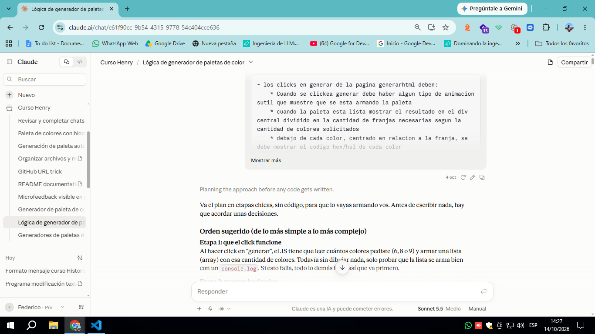
**R:** Plan en 5 etapas: click, franjas con flex, código dentro de la franja, animación con clase CSS + setTimeout y guardado con JSON. Errores previsibles (doble click, guardar sin generar, pisar paletas anteriores) y 3 decisiones a acordar.

> **P:** ¿Lo primero es poner un event listener al botón?

**R:** Sí. Se agarra el botón con getElementById y se usa addEventListener("click", ...). Se prueba con console.log y se avisa del error "Cannot read properties of null".

> **P:** Revisión de mi código: ¿id en vez de querySelectorAll?, ¿qué pasa con forEach?, ¿leer formato y cantidad antes de generar?

**R:** Sí a los tres. Sin forEach el listener va directo al botón. Se marcó un error de llaves: el segundo console.log quedaba fuera del listener. Orden: leer valores, después generar.

> **P:** Tengo dos select, ¿cómo los leo?

**R:** Con .value, siempre adentro del listener para leer el valor actual. .value devuelve texto, así que hay que convertirlo a número.

> **P:** Revisión de mi código con getElementById y los dos select.

**R:** Tres errores: el punto en ".gen-paleta" dentro de getElementById, el .value dentro de las comillas ("cantidad.value") y la falta de id en el botón.

> **P:** Pasame el código acomodado con clases y buenas prácticas.

**R:** Código con querySelector, const en vez de var, elementos buscados afuera del listener y .value leído adentro, con explicación de cada parte.

> **P:** Objeción: hay que volver a buscar los elementos porque cambian.
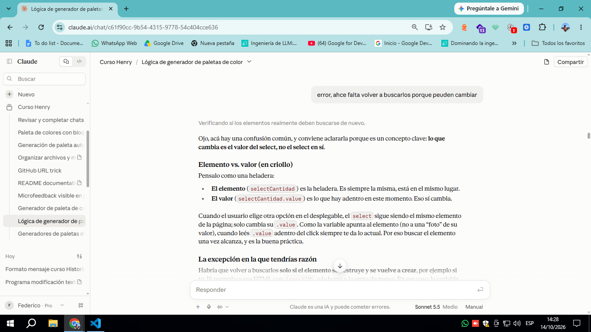
**R:** Cambia el valor, no el elemento (analogía de la heladera). Habría que volver a buscarlos solo si JS los recrea con innerHTML. Se propuso probarlo cambiando el select y clickeando.

> **P:** Puse el código y no se loguean los valores.

**R:** Diagnóstico en 3 chequeos: que cargue el script, errores rojos y botón dentro de un form o filtro de consola.

> **P:** Consola con "Script cargado" y un 404 de favicon.ico.

**R:** El favicon es ruido. Sin error null parecía que los elementos se encontraban, y se sospechó de un form o de clases repetidas (querySelectorAll(".gen-paleta").length).

> **P:** ¿Dónde está "Preserve log"? ¿Es "Keep log on navigation"?

**R:** Está en el engranaje de la consola (Chrome/Edge) y en Firefox se llama "Persist Logs". Es la misma opción y conserva los mensajes cuando la página se recarga.

> **P:** El .length dio 2.

**R:** Hay dos elementos con la clase gen-paleta y querySelector toma solo el primero. Caminos: A) querySelectorAll + forEach, B) clases o ids distintos, C) borrar uno.

> **P:** Error "Cannot read properties of null (reading 'value')" en script.js:8.

**R:** .cantidad no existía en el HTML: querySelector devuelve null en silencio y el error aparece recién al usar .value. Se corrigió mi afirmación anterior de que "los tres elementos se habían encontrado".

> **P:** Los selects tienen id (cantidad y for-c).

**R:** Se cambió a getElementById("cantidad") y getElementById("for-c"), sin punto, y se mantuvo querySelector para el botón.

> **P:** La consola muestra 9 y HSL, pero también un error viejo.

**R:** Funciona. El error rojo quedaba por "Preserve log" y venía de probar en la versión publicada (github.io) y no en el archivo local. Los valores salían dos veces por clickear dos veces.

> **P:** Dejé un solo botón con la clase y ahora, ¿cómo sigue la lógica?

**R:** Pasos 3-5: convertir la cantidad con Number(), una función que fabrica un color y un for que llena un array. Se sugirió crear el array adentro del listener para que no se acumule entre clicks.

> **P:** Me aparece "undefined".

**R:** Tres causas posibles: función sin return, variable mal nombrada o propiedad mal escrita (.valor). Se pidió el código y el log exacto.

> **P:** Salió 6 y HEX, pero console.log(typeof cantColores) dio undefined.

**R:** Era un problema de scope: lo escribí en la consola, fuera del listener, donde cantColores no existe. Se dio const cantColores = Number(selectCantidad.value) con typeof adentro del listener.

> **P:** Cambiemos el formato y pasame el código.

**R:** Función generarColor(formato) con ramas "HSL" (Math.random, h/s/l y return) y "HEX" (toString(16) y padStart). Va afuera del listener y se prueba con console.log. Falta sumar RGBA.


---

### Sesión 05/10/2026 (mañana y tarde)

> **P:** Armar una paleta aleatoria según la cantidad y el formato elegidos en los selects, usando Math.random y teoría del color.
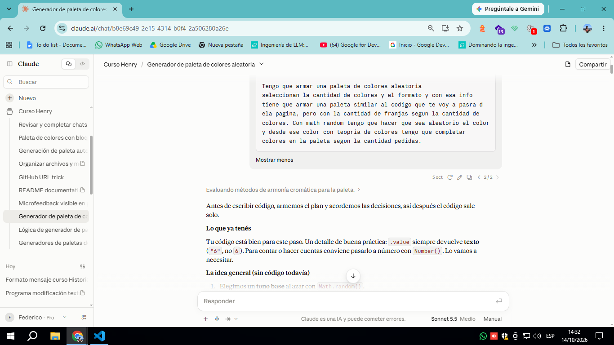
**R:** Antes de codear se acordó el plan. Todo se calcula en HSL, y los demás colores salen con la opción B (análogos: se suma un paso fijo al tono base). El HEX se convierte solo al mostrar. Se anticiparon errores: redondear con Math.floor, usar % para pasar de 360°, y vaciar la paleta anterior en cada click.

> **P:** Confirmé las decisiones (HSL, B, HEX solo al mostrar) y pasé el HTML. Pedí que me guíe paso a paso.

**R:** Se detectó que faltaba &lt;/footer&gt; en el HTML. Se armó el mapa de 5 pasos. Paso 1: pasar la cantidad con Number() y crear tonoBase = Math.floor(Math.random() * 360).

> **P:** Aclaré que el usuario ve el formato que elige pero el código trabaja siempre en HSL, y pegué la consola (tonoBase = 148).

**R:** Se confirmó que el select se queda y que la conversión a HEX solo afecta lo que se muestra. Paso 2: array tonos + for + constante PASO = 30 + % 360 para que el tono dé la vuelta.

> **P:** Pregunté si el código del for va dentro de la función inicial.

**R:** Va dentro de la función del click, porque las variables declaradas adentro solo existen ahí. Además, con const tonos = [] adentro el array arranca vacío en cada click y no se acumulan tonos.

> **P:** Pedí que me expliquen % 360 y que revisen mi for (iteré 2 veces).

**R:** % es el módulo (resto de la división), como un reloj: 370 % 360 da 10. 1ª vuelta: tonoBase era const y se reasignaba, tonoBase%360; no guardaba el resultado y se pisaba el valor base en cada vuelta. 2ª vuelta: quedó correcto. Solo se ajustaron const en vez de let, el nombre tonoFinal y PASO en mayúsculas.

> **P:** Pedí orientación para crear las franjas con JS (opción B).

**R:** contenedor = document.querySelector(".color-line") y contenedor.innerHTML = "" para vaciar. Dentro del for: createElement, classList.add, appendChild y style.backgroundColor. Las constantes SATURACION y LUMINOSIDAD se declaran arriba.

> **P:** Crear una franja por cada tono (iteré 3 veces).

**R:** 1ª: backgroundColor = tonoFinal no pinta, hace falta el texto `hsl(${tonoFinal}, ${SATURACION}%, ${LUMINOSIDAD}%)` (template string); faltaba el div.c y el for debía usar cantColNum. 2ª: los 4 elementos iban sueltos a contenedor, hay que anidarlos con franjaVertical.appendChild(...); el typo franjatexto1 rompía todo (JS distingue mayúsculas); sobraban clases en los &lt;p&gt;. 3ª: quedó funcionando con textContent para los textos.

> **P:** Mostrar en el texto 1 el formato elegido y en el texto 2 los valores según HSL o HEX.

**R:** Texto 1 = formatoColores directo. Texto 2 con if/else. Se dividió la conversión HSL → HEX en 5A (el if/else) y 5B (la función).

> **P:** Pegué mi if/else, que andaba bien para HSL.

**R:** En la rama HEX faltaba el segundo &lt;p&gt;: había que crearlo antes del if. También se corrigió == por === y los ; que faltaban. Se explicó numeroAHex con toString(16) y padStart(2, "0").

> **P:** Dije que la fórmula era muy avanzada y pedí las funciones directamente.
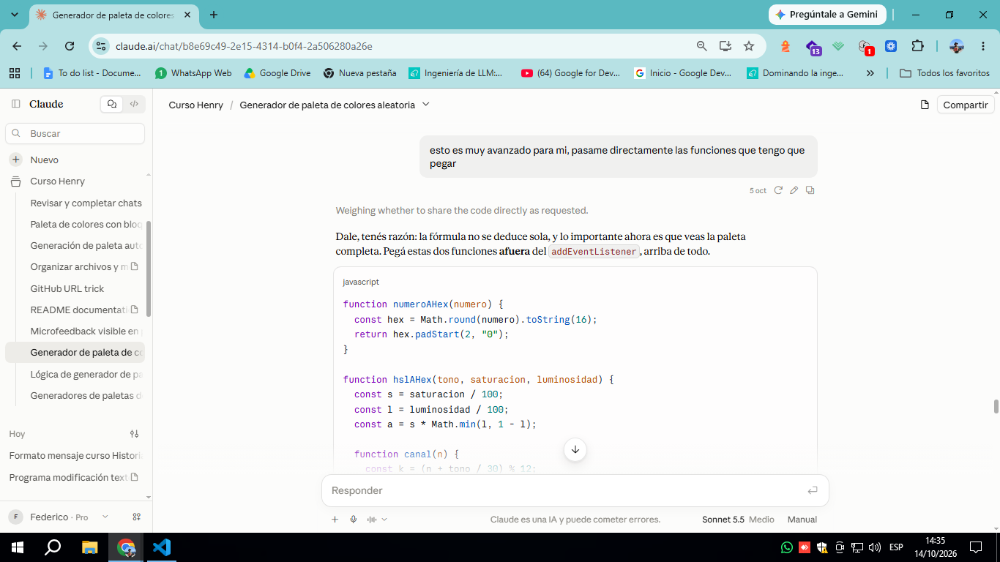

**R:** Se dieron numeroAHex y hslAHex (HSL → RGB → HEX, con la función interna canal), explicadas como "caja negra": qué entra y qué sale. Se mostró el else con hslAHex(tonoFinal, SATURACION, LUMINOSIDAD). Prueba: hslAHex(0, 100, 50) da "#ff0000".
>ACLARACIÓN: estas formulas son la unica parte del codigo que no pude escribir por mi mismo y se las pedi directamente al agente

> **P:** Pregunté dónde se declaran esas funciones.

**R:** Afuera del addEventListener, después de las const iniciales, con numeroAHex primero. Adentro se recrearían en cada click sin necesidad.

---

### Sesión 07/10/2026 (mañana)

> **P:** Quiero que el proyecto tenga microfeedback visible (tooltip, toast u otro equivalente).
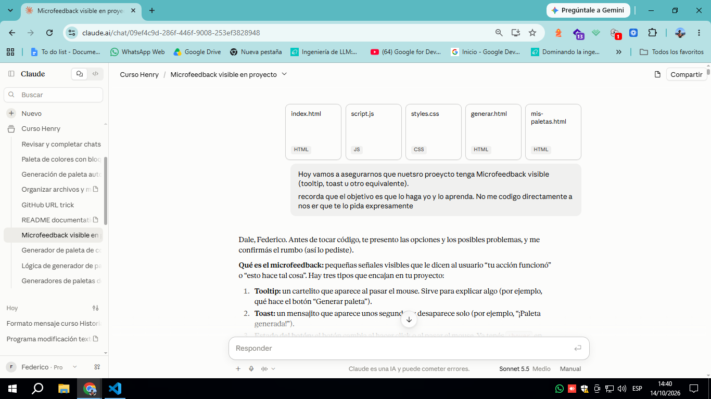

**R:** Se explicaron los tipos de microfeedback (tooltip, toast, estado del botón) y se propuso toast al generar paleta más tooltip en los selectores. Se anticiparon dos bugs: script.js se carga en todas las páginas y botonGenerar es null fuera de generar.html, y los setTimeout se pisan con clicks rápidos.

> **P:** Elijo el toast, centrado sobre la paleta, 2 segundos, con el texto "Generaste una nueva paleta".

**R:** Como contenedor.innerHTML = "" borra todo lo que hay dentro de .color-line, el toast tiene que ser hermano y no hijo. Se pidió un wrapper alrededor de .color-line y el plan en 3 pasos: HTML, CSS y JS. Paso 1: wrapper más div.toast con el texto.

> **P:** No quiero pasarte mi HTML, prefiero validarlo yo.
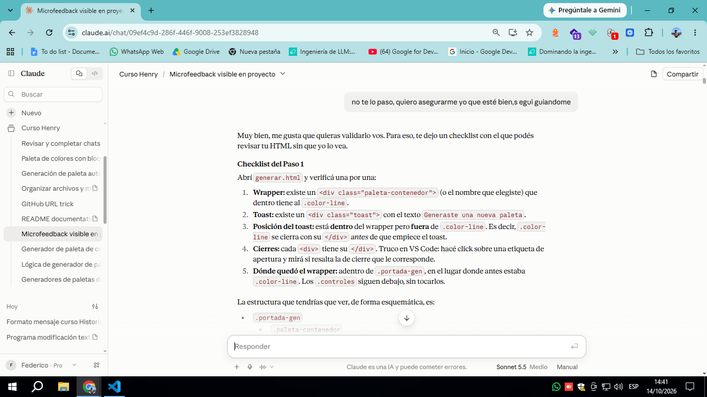
**R:** Se dio un checklist de estructura (wrapper > .color-line + .toast, cierres de &lt;/div&gt;) y una prueba visual en el navegador.

> **P:** Avancemos con el CSS.

**R:** Se explicó position: relative en el wrapper, position: absolute con top/left: 50% y transform: translate(-50%, -50%) en el toast, opacity: 0 para esconderlo y la clase .toast.visible con opacity: 1. También se detectó font-size: 0,5rem con coma, que debe ser 0.5rem.

> **P:** "Escondamos el toast".

**R:** Se dio un checklist de opacity: 0, pointer-events: none y transition. Si no se ve el cambio, probar recarga forzada con Ctrl + Shift + R o buscar otra regla .toast que pise.

> **P:** Te paso mi CSS, pero no entendí pointer-events ni transition.

**R:** Errores corregidos: wrap-toast sin punto (debe ser .wrap-toast) y 1.5 rem con espacio (debe ser 1.5rem). transition: opacity 0.3s ease hace que el cambio sea gradual (propiedad, duración, ritmo). pointer-events: none hace que el mouse ignore al toast aunque esté invisible.

> **P:** Todavía no puse opacity: 1 en ningún lado.

**R:** Se indicó crear .toast.visible (sin espacio entre clases) debajo de .toast, con opacity: 1. Se explicó la diferencia con .toast .visible (con espacio) y se sugirió probarlo agregando visible a mano en el HTML.

> **P:** Vamos con el JS.

**R:** Se guiaron tres piezas: document.querySelector(".toast"), classList.add("visible") y setTimeout(..., 2000). Para evitar el bug de clicks rápidos se agregaron let para guardar el temporizador y clearTimeout antes de programar el nuevo.

> **P:** Te paso mi script, el toast no aparece y algo no anda.

**R:** Diagnóstico en varias vueltas. 1ª: faltaban setTimeout y clearTimeout, y se pidió consistencia con ;. 2ª: se revisó la regla .toast.visible y se explicó Array(9) y el aviso file:/// de la consola (no es un error del código). 3ª: se pidió mirar la clase del div en F12 > Elements y probar con console.log(toastGen). 4ª: la captura mostró que el &lt;div class="toast"&gt; no estaba en el HTML, así que querySelector devolvía null. Lo encontraste y lo corregiste vos.

> **P:** Ahora que desaparezca.

**R:** Se explicaron la variable let del temporizador, clearTimeout antes de classList.add y setTimeout guardado en la variable, con función y 2000 ms.

> **P:** Pasame la función directamente.

**R:** Se entregó el bloque corto con clearTimeout(temporizador), classList.add("visible") y temporizador = setTimeout(function () { ... }, 2000), explicado línea por línea. Se sugirió sacar los console.log de prueba.

> **P:** Te paso mi versión con toastGen.clearTimeout(temp).

**R:** Errores: clearTimeout es una función global y no un método del elemento (sobra toastGen.); temp debe declararse con let temp; arriba; faltaba un ;. Se sugirió un nombre más descriptivo como temporizadorToast. Quedó funcionando.

> **P:** Vamos con algún tooltip en index.html.

**R:** Se presentaron opciones (botón "Generador", logo, links del navbar) y dos caminos: atributo title o tooltip con CSS. Riesgos anticipados: ::after no funciona sobre &lt;img&gt;, el &lt;button&gt; dentro de un &lt;a&gt; es HTML inválido, bordes de pantalla y falta de hover en celular.

> **P:** ¿Qué tooltips hay?
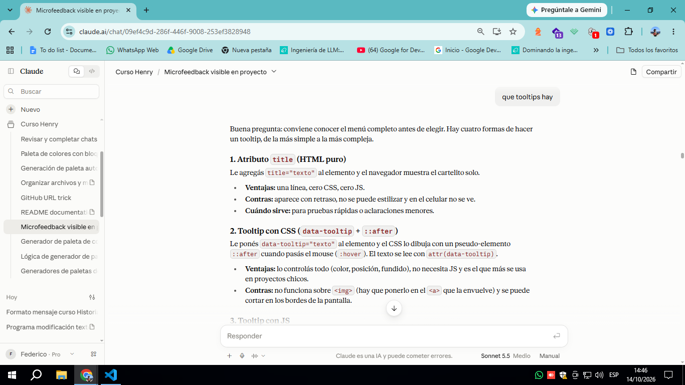
**R:** Se listaron cuatro tipos: atributo title, CSS con data-tooltip + ::after, JS con mouseenter/mouseleave y librerías (Tippy.js, Popper.js). Se recomendó el de CSS.

> **P:** Voy con el B, que diga "Acceder al generador de paletas".

**R:** Se acordó poner data-tooltip en el &lt;button&gt;. Plan: Paso 1 HTML con el atributo, Paso 2 CSS con position: relative en el botón, .btn::after con content: attr(data-tooltip), position: absolute, bottom: 100%, centrado, opacity: 0 y transition, y .btn:hover::after con opacity: 1.

> **P:** ¿Cómo es el formato para pasar el data?

**R:** Se explicó data-nombre="valor" dentro de la etiqueta de apertura. El nombre debe coincidir letra por letra con el de attr(...) en el CSS.

> **P:** Sigamos.

**R:** Se detallaron las tres reglas CSS del tooltip (referencia relative, ::after escondido, :hover::after visible) con avisos sobre herencia de color y font-weight del botón.

> **P:** No entiendo por qué bottom: 100% lo pone arriba, ni el centrado con left: 50% + translateX(-50%), y quiero entender mejor transition.

**R:** bottom: 100% apoya el borde inferior del cartel en el borde superior del botón. El centrado se hace en dos pasos: left: 50% ubica el borde izquierdo en el medio y translateX(-50%) corre el cartel la mitad de su propio ancho (ejemplo con números). transition se compone de propiedad, duración y ritmo (ease), y va en el estado base para animar la ida y la vuelta.

> **P:** ¿Puedo poner 110%?

**R:** Sí, es válido. Genera una separación proporcional a la altura del botón, pero se suma al margin-bottom. Se recomendó 100% + margin-bottom para una distancia fija, y probar valores en vivo en F12.

> **P:** Te paso mi CSS con .btnPortada (tooltip del botón de portada).

**R:** Estructura correcta (position: relative, content: attr(), centrado, transition). Faltaba .btnPortada:hover::after con opacity: 1. El opacity: 0.7 en el hover del botón también afecta al ::after por herencia. bottom: -130% deja el cartel debajo del botón. Verificar que la clase del HTML sea btnPortada y definir color explícito en el ::after.

> **P:** Explicame bien cómo funciona ::after.

**R:** Es un pseudo-elemento que aparece como último hijo del elemento y necesita content para existir. attr(data-tooltip) lee el texto del HTML. Hereda estilos del padre, y por eso el botón necesita position: relative. Se explicó la diferencia entre :: (pseudo-elemento) y : (pseudo-clase), sus limitaciones (no funciona en &lt;img&gt;/&lt;input&gt;) y cómo verlo en F12.

---

### Sesión 07/10/2026 (tarde)

> **P:** Quiero que al hacer clic sobre un color de la paleta se copie el código al portapapeles.
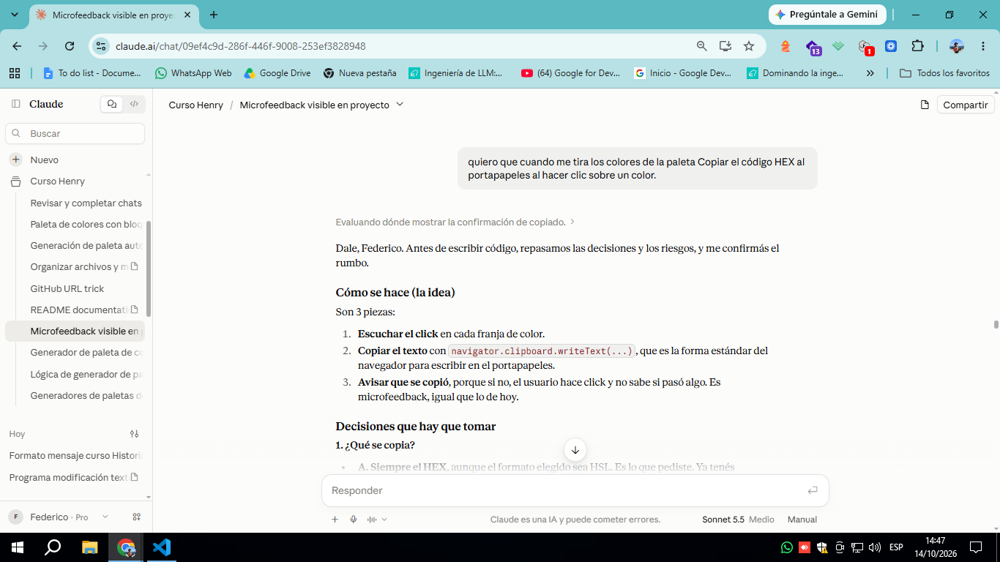
**R:** Se presentó la idea en 3 piezas: escuchar el click en cada franja, copiar con navigator.clipboard.writeText(...) y avisar con microfeedback. Se plantearon decisiones (qué copiar, dónde va el listener, cómo avisar) y riesgos: file:/// puede limitar el portapapeles, writeText devuelve una promesa y los dos toasts podrían pisarse.

> **P:** Decisiones: se copia lo que se muestra abajo (los dos &lt;p&gt;), listener en cada franja, segundo toast solo para copiar y avisar que se puede copiar.

**R:** Se dejó cerrado el rumbo y se propuso copiar solo el valor (no la etiqueta HEX/HSL), con un aviso fijo en la página, cursor: pointer y un segundo toast con clases toast + toast-copiar. Para que no se pise con el primero, el JS lo busca por .toast-copiar y usa su propia variable de temporizador.

> **P:** Copiar solo el valor, aviso con texto fijo, toast "Color copiado", y ¿dónde está el cursor?

**R:** Paso 1 (HTML): segundo div.toast.toast-copiar hermano del primero, fuera de .color-line, y un &lt;p class="aviso-copiar"&gt; también fuera de .color-line para que innerHTML = "" no lo borre. cursor: pointer cambia el puntero a manito para indicar que algo es clickeable.

> **P:** Pienso poner el listener fuera de la función, porque la paleta ya tiene que estar lista.
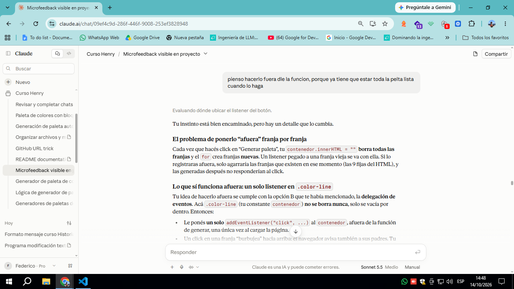
**R:** Se explicó que innerHTML = "" borra las franjas y los listeners viejos con ellas, por lo que un listener "afuera" solo agarraría las franjas existentes. Se ofreció la delegación de eventos (event.target.closest(".color")) en .color-line.

> **P:** Volvamos a la opción anterior (un listener por franja) y prefiero que sea solo el cuadrado.

**R:** Se volvió al listener en cada franja dentro del for, sobre franjaColor, con cursor: pointer en .c y no en .color. El valor a copiar sale de franjaTextoValores.textContent, que el listener "recuerda" por closure. Se sugirió probar en pasos: console.log, luego writeText, luego el toast.

> **P:** Al pegar sale [object HTMLParagraphElement].

**R:** Lo encontraste vos: se estaba copiando el elemento &lt;p&gt; entero y no su texto. La propiedad es .textContent (con la C mayúscula): a la izquierda del = escribe y como valor lee. Pista general: [object ...] significa que se pasó el objeto en vez de una propiedad.

> **P:** ¿Por qué los selects no tienen la fuente del resto de la página?

**R:** Los elementos de formulario (select, button, input) traen su fuente propia y cortan la herencia. Solución: font-family: inherit. Además, el @import trae Nunito pero el body pide 'Nunito Sans', que no está importada.

> **P:** Apliqué inherit y el select sigue distinto; te paso lo que dice Computed.

**R:** La herencia funcionaba: font-family muestra la lista del body y Rendered fonts muestra Segoe UI, porque Nunito Sans no existe y el navegador cae en la siguiente de la lista. El arreglo real es cambiar 'Nunito Sans' por 'Nunito' en el body. Se sugirió dejar una sola regla font-family: inherit en vez de dos duplicadas.

> **P:** ¿Por qué la frase "Hacé click en un color..." sí tiene la fuente de la página?

**R:** Es un &lt;h3&gt;, y la regla h1, h2, h3 le asigna Fredoka, que sí está importada, sin depender de la herencia. Se anotó que, como es un aviso y no un título, conviene que más adelante sea un &lt;p&gt; con clase propia.

> **P:** VS Code marca "} expected" en styles.css.

**R:** Falta una llave de cierre en alguna regla anterior. La pista fue el sticky scroll de VS Code, que mostraba .btnPortada::after dentro de label, select. Se indicó ir a la línea 243 con Ctrl + G, buscar la } faltante y verificar con Shift + Alt + F. Lo resolviste vos. Se marcó que opacity: 0.7 en .btnPortada:hover::after deja el tooltip semitransparente.

> **P:** Te paso mi versión del listener con el toast de copiar.

**R:** La lógica estaba bien (toast y temporizador propios, clearTimeout), pero faltaban dos cosas: el nombre decía ranjaColor y no cerraba el addEventListener, y el aviso estaba afuera de la promesa, así que se mostraría aunque la copia fallara. Corrección: mover el toast adentro de .then(...).

> **P:** Pasame toda la función para comparar.

**R:** Se entregó el bloque completo: franjaColor.addEventListener("click", ...) con navigator.clipboard.writeText(franjaTextoValores.textContent).then(...) y adentro clearTimeout(tempCopiar), classList.add("visible") y setTimeout(..., 1000). Los cierres son }, 1000); y dos });.

### Sesión 09/10/2026 (mañana)

> **P:** Quería entender paso a paso las funciones `numeroAHex` y `hslAHex` (conversión de HSL a HEX).
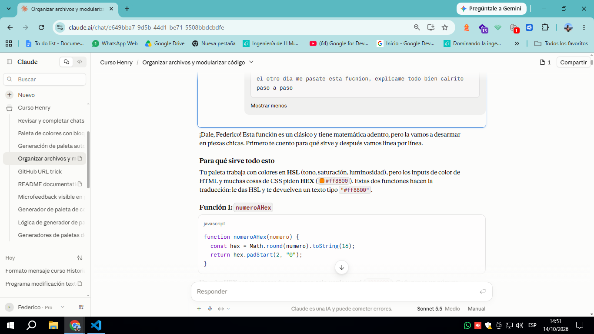
**R:** `numeroAHex` redondea con `Math.round`, convierte a base 16 con `.toString(16)` y completa con `.padStart(2, "0")`. `hslAHex` normaliza `saturacion` y `luminosidad` a 0–1, calcula `a` con `Math.min` y usa la función interna `canal(n)` (n = 0, 8, 4 para R, G, B). Se explicó el scope (`canal` accede a variables de `hslAHex`) y la buena práctica de funciones chicas de una sola tarea.

> **P:** Consulta conceptual: `Math.round`, si redondea para arriba o para abajo.

**R:** Redondea al entero más cercano (.5 o más sube). Alternativas: `Math.floor()` (siempre abajo) y `Math.ceil()` (siempre arriba). En `numeroAHex` se usa `Math.round` para que el color quede lo más fiel posible.

> **P:** Pegó la función del click de "Generar" y quiso revisar si es demasiado larga y si conviene modularizarla.

**R:** La función mezcla varios trabajos (leer selects, tono base, limpiar, crear elementos, formatear texto, copiar con toast). Se propusieron tres modularizaciones graduales: A) función del texto HSL/HEX, B) función de copiar con toast, C) función que arma la franja. Se advirtió pasar datos por parámetro y mover `PASO`, `SATURACION` y `LUMINOSIDAD` afuera.

> **P:** Pegó el `script.js` completo para seguir con la modularización.

**R:** Se confirmó que el código estaba completo y que `tonos` (`const tonos = []`) crece con `tonos.push` en cada click sin vaciarse; `tonosUltPal` y `tonosBloq` aún no se usan. Detalles de prolijidad: `;` faltantes en `temp` y `tempCopiar`. Plan propuesto 0 → A → B, dejando C y unificar toasts para después (porque `temp` y `tempCopiar` se reasignan).

> **P:** Pidió cambiar la modalidad: él recorre el código y pregunta si algo se puede modularizar, y yo explico por qué sí, por qué no o qué es buena práctica.

**R:** Se aceptó (sin código hasta que lo pida). Quedaron pendientes el uso de `tonos`/`tonosUltPal`/`tonosBloq` y la prolijidad (`;`, constantes arriba).

> **P:** Consulta si `cantColores`, `formatoColores`, `cantColNum` y `tonoBase` se pueden declarar afuera de la función del click.

**R:** Deben quedar adentro: `.value` de los selects y `Math.random()` se tienen que leer en cada click; afuera quedarían congelados. Regla: si el valor cambia según el click va adentro, si es fijo va afuera. `.value` devuelve texto, por eso se usa `Number()`.

> **P:** Consulta si se pueden declarar afuera y darles valor adentro, o si es mala práctica.

**R:** Técnicamente se puede solo con `let` (`const` exige valor al declararse), pero es mala práctica: amplía el scope y conserva valores entre clicks. Va afuera solo lo que debe sobrevivir entre clicks o compartirse (`temp`, `tempCopiar`). Regla: empezar con `const` y adentro.

> **P:** Consulta si `PASO`, `SATURACION` y `LUMINOSIDAD` se dejan en la función o se declaran afuera.

**R:** Conviene subirlas: son valores fijos, no se recrean en cada click, quedan centralizadas y otras funciones las podrán usar. Se mantienen como `const` en MAYÚSCULAS (convención de constantes).

> **P:** Consulta si esas constantes van al principio del código o sobre la función.

**R:** Al principio del archivo, con el resto de las declaraciones. Orden sugerido: elementos del DOM, variables de estado, constantes fijas, funciones auxiliares, evento del click.

> **P:** Consulta cómo se llama el tipo de información que guardan `botonGenerar`, `selectCantidad`, `contenedor`, `toastGen`, etc.

**R:** Son referencias a elementos del DOM (objetos que representan las etiquetas HTML). Si `querySelector`/`getElementById` no encuentran el elemento devuelven `null`, por eso funciona el `if (botonGenerar)` en `mis-paletas.html`. Se comparó `querySelector` (selector CSS) con `getElementById` (solo id) y se sugirió consistencia.

> **P:** Consulta qué título de comentario ponerle a ese grupo de variables.

**R:** `// elementos del DOM`, por ser el nombre técnico real del tipo de dato. Se propuso titular igual los otros bloques: `// variables de estado` y `// valores fijos de la paleta`.

> **P:** Consulta sobre buenas prácticas para organizar carpetas y vincular CSS, JS y páginas (uno por página o uno solo en proyectos chicos).

**R:** HTML en la raíz y carpetas `css/`, `js/`, `img/`, vinculados con `<link rel="stylesheet" href="css/styles.css">` y `<script src="js/script.js" defer>`. En proyectos chicos, un solo CSS; para JS, un script por página con lógica distinta y un `utils.js` compartido. El `if (botonGenerar)` es un parche por cargar el mismo script en ambas páginas.

> **P:** Comentó que vio proyectos con una carpeta `pages/` para los otros HTML.

**R:** Es válido: `index.html` queda en la raíz y el resto va en `pages/`. Cambian las rutas relativas al HTML (desde `pages/` se sube con `../css/styles.css`). Con dos páginas no hace falta; conviene desde cuatro o cinco. Si algo no carga, revisar el 404 en consola/Network.

> **P:** Dudó de poder modularizar el `for` que arma las franjas, porque en cada click tiene que armar la paleta.

**R:** Modularizar no impide que se ejecute en cada click: una función corre cada vez que se la llama. Se propuso sacar primero el `if/else` HSL/HEX y luego una `crearFranja(tonoFinal, formatoColores)` que devuelva la `franjaVertical`. En el `for` quedan el cálculo de `tonoFinal` y `tonos.push` (separar el qué del cómo).

> **P:** Pidió un ejemplo completo de la modularización y luego un archivo entero para compararlo con el suyo.

**R:** 1ª: se entregó en piezas (constantes arriba, `textoColor(tono, formato)` con `return`, `crearFranja` y el `for` reducido), con lista de pruebas (HSL/HEX, copiar, toast, consola F12). 2ª: se entregó `script-modularizado.js` completo para comparar, con los `;` faltantes agregados. Él decidió dejar su código como estaba por ahora.

> **P:** Pidió explicación paso a paso del bloque del toast (`clearTimeout(temp)`, `classList.add("visible")`, `temp = setTimeout(...)`).

**R:** `classList.add("visible")` muestra el toast y `setTimeout(fn, 1000)` programa su ocultamiento y devuelve un ID que se guarda en `temp`. `clearTimeout(temp)` cancela el temporizador anterior, para que con clicks rápidos el toast dure 1 segundo desde el último. `temp` va afuera para sobrevivir entre clicks. Se mencionó el patrón de debounce.

> **P:** Consultó si `toastGen.classList.remove("visible")` es un método que se ejecuta dentro de una función.

**R:** Es correcto: es un método (función que pertenece a un objeto, se llama con punto) dentro de una función anónima que `setTimeout` ejecuta 1 segundo después. Se diferenció función suelta de método y se presentó el término callback.

> **P:** Consulta qué es `.then` en `navigator.clipboard.writeText(...).then(...)` y por qué va con punto.

**R:** `writeText` devuelve una promesa (algo que todavía no terminó) y `.then` es su método: recibe un callback que corre solo cuando termina bien. Así el toast "copiado" aparece recién después del copiado. Se mencionó `.catch` para fallos y `async/await` como tema futuro.

> **P:** Dudó si siempre que una función se asigna a una variable se ejecuta, a partir de `temp = setTimeout(function () {...}, 1000)`.

**R:** `temp` no guarda la función sino el ID que devuelve `setTimeout`. Una función se ejecuta solo cuando se la llama con `()`; asignarla o pasarla no la ejecuta. Error clásico: `setTimeout(ocultarToast(), 1000)` (se ejecuta ya) frente a `setTimeout(ocultarToast, 1000)` (correcto).

### Sesión 09/10/2026 (tarde)

> **P:** Preguntó qué quedó pendiente, mencionando el array que se sumaba y algo más.

**R:** Pendiente principal: `tonos` crece con `tonos.push` en cada click sin vaciarse, y había que confirmar para qué pensaba usar `tonos`, `tonosUltPal` y `tonosBloq`. Otros pendientes: función de copiar (B), unificar toasts, `.catch` en el portapapeles, prolijidad (`;` y espacios), consistencia entre `querySelector` y `getElementById`, y el `if (botonGenerar)` como parche.

> **P:** Propuso convertir `tonos` en `let` y hacer `tonos = []` al iniciar el event listener.

**R:** Funciona y respeta su lógica: con `let` se puede reasignar y `tonos = []` reemplaza el array por uno nuevo. Diferencia con `tonos.length = 0`: los arrays se asignan por referencia, así que `length = 0` vaciaría también un `tonosUltPal = tonos`. Va al principio del click junto a `contenedor.innerHTML = ""`.

> **P:** Preguntó si `tonos` realmente no tiene función en el script tal como está.

**R:** Correcto: se llena con `tonos.push` pero nunca se lee, igual que `tonosUltPal` y `tonosBloq`. Es código muerto; buena práctica: no dejar código sin función ni escribir lo que todavía no se necesita. Opciones: borrarlas hasta armar el bloqueo o dejarlas con un comentario (`// reservado para el bloqueo de colores`).

> **P:** Anunció que va a sacar el `push` de donde está y juntar el código en el formato que pida el usuario (HSL o HEX).

**R:** Se pidió confirmar la intención antes de programar: lectura 1 (el array guarda el texto final de cada color, con el `push` después del `if/else`) o lectura 2 (unificar el `if/else`). Se plantearon decisiones pendientes (qué se guarda, si se vacía en cada click, qué pasa si cambia el formato sin regenerar) y se sugirió un nombre más fiel que `tonos`.

> **P:** Mostró que ya funciona el array con los códigos según el formato (captura de la consola con HSL y HEX) y pidió ayuda para pensar cómo guardarlo en `localStorage`, sin saber cómo funciona.

**R:** Se explicó `localStorage` (pares clave-valor persistentes, `setItem`, `getItem`, `removeItem`), que solo guarda texto (`JSON.stringify` para guardar, `JSON.parse` para leer), que no se puede "agregar" sino leer, sumar y volver a guardar, y que `getItem` devuelve `null` si no existe la clave. Se plantearon las decisiones previas a programar y se señalaron los 4 errores rojos que mostraba DevTools.

> **P:** Respondió las decisiones (varias paletas, duplicados permitidos, primera paleta al cargar, sin aviso por ahora) y pegó `paletaGuardada.push({formato: hslAHex, color: ...})`.

**R:** 1ª: error, `hslAHex` es la función y hay que guardar el formato (`JSON.stringify` descarta funciones en silencio); además un `push` por color arma un array plano que no separa paletas. 2ª: corrigió a `formato: "HSL"` (texto), que ya se guarda bien; debe haber un `push` en cada rama o uno solo después del `if/else` con `formato: formatoColores`. Se propuso una paleta como objeto y la función `generarPaleta` para llamarla también al cargar.

> **P:** Confirmó el objeto por paleta y renombró los arrays a `paletaActual` y `paletasGuardadas`; consultó cómo declarar `paletasGuardadas` sin que quede vacía en cada arranque.

**R:** Al cargar hay que leer desde `localStorage`: `JSON.parse(localStorage.getItem("clave")) || []` (`getItem` devuelve `null` la primera vez y `|| []` lo cubre). `paletasGuardadas` puede ser `const` porque solo recibe `push`; la clave debe ser siempre idéntica (conviene una constante arriba). Se plantearon dos opciones para `paletaActual`: A) objeto armado en cada click o B) array de textos.

> **P:** Pegó el listener de "Guardar": `JSON.parse(localStorage.setItem("paletasGuardadas", paletaActual))`, y después el script completo porque se guardaba `'[]'`.

**R:** 1ª: `JSON.parse` envuelve a `setItem` (que devuelve `undefined`; al guardar va `JSON.stringify`), `setItem` solo acepta texto (si no, queda `"[object Object]"`) y se guardaba `paletaActual` en vez de la lista, pisando la anterior. 2ª: con el script completo se vio que faltaba `paletasGuardadas.push(paletaActual);` antes del `setItem` (el orden importa). Las paletas no se pisan porque `paletaActual = []` crea un array nuevo en cada click.

> **P:** Consulta cómo ver el contenido de `localStorage`.

**R:** DevTools (F12) > Application > Storage > Local Storage > seleccionar la página; ahí se ven clave y valor, con opción de borrar filas y refrescar. También se puede ver desde la consola con `localStorage.getItem("paletasGuardadas")`. El almacenamiento es por sitio y por navegador: `file://` y Live Server (`localhost`) son orígenes distintos.

> **P:** Ejecutó `localStorage.getItem("paletasGuardadas")` y obtuvo `'[]'`.

**R:** Significa que la clave existe y guarda una lista vacía en texto (el `JSON.stringify` funciona), pero no se sumó ninguna paleta. Se propusieron causas posibles (`setItem` antes del `push`, guardar `paletaActual`, `paletaActual` sin llenar, guardar sin haber generado) y escribir `paletaActual` y `paletasGuardadas` en la consola para diagnosticar.

> **P:** Ejecutó `getItem` dos veces y obtuvo varias paletas guardadas.

**R:** El guardado funciona: las paletas se suman y persisten entre sesiones, con la estructura lista de paletas y cada paleta lista de `{formato, color}`. Se detectó una paleta vacía (`[]`) al principio, guardada al apretar "Guardar" sin haber generado nada. Se propusieron generar la primera paleta al cargar y/o una guarda `if (paletaActual.length === 0) return;`, y borrar esa entrada desde Application > Local Storage.

### Sesión 11/10/2026 (manana y tarde)
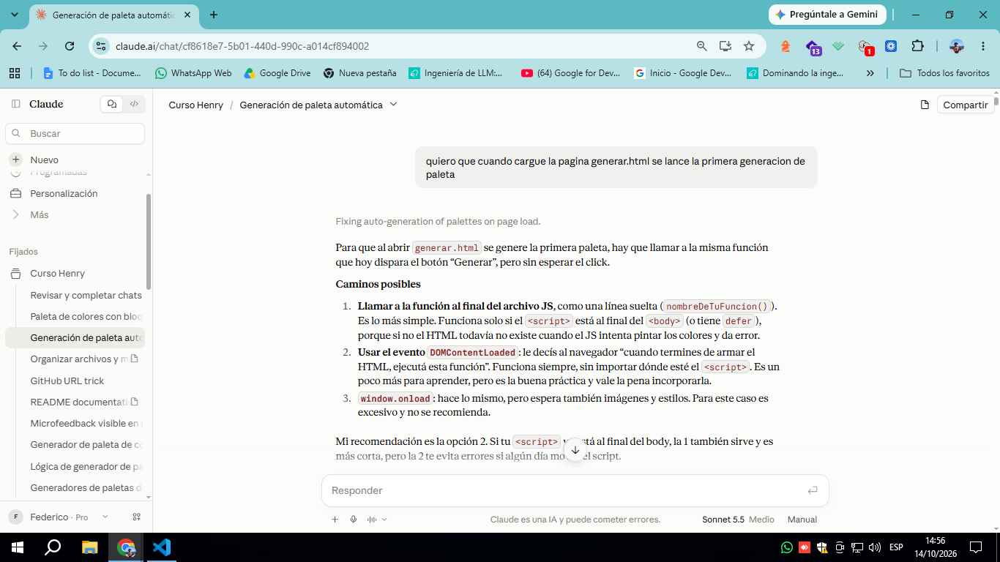
> **P:** Consulta cómo hacer que la primera paleta se genere sola al cargar `generar.html`.

**R:** Hay que llamar a la misma función del botón sin esperar el click. Se explicaron tres caminos: llamada suelta al final del JS, `DOMContentLoaded` y `window.onload`. Como el `<script>` está en el `<head>` con `defer`, alcanza con la llamada suelta, porque `defer` ejecuta el JS cuando el HTML ya está armado.

> **P:** Pregunta si debe declarar la función primero, después el listener y al final llamarla.

**R:** Sí. La función anónima se saca del `addEventListener` y se le pone nombre. El listener recibe el nombre **sin paréntesis** y la llamada final lleva paréntesis. Se dio un esqueleto de 3 bloques.

> **P:** Consulta cómo comentar una línea y un grupo de líneas en VS Code.

**R:** `Ctrl + /` comenta y descomenta líneas sueltas o seleccionadas. Para un comentario de bloque único se usa `Shift + Alt + A`. Cada lenguaje tiene su sintaxis: `//`, `<!-- -->` y `/* */`. Buena práctica: comentar el porqué, no el qué.

> **P:** Pasó su código y la paleta no se generaba.

**R:** Causa: `addEventListener("click", generarPaletaNueva())` con paréntesis ejecuta la función en el momento y le pasa `undefined` al listener. Solución: sacar los paréntesis. Se recomendó mirar la consola (`F12`) ante cualquier error.

> **P:** Consulta cómo poner el icono al lado del título en la pestaña del navegador.

**R:** Es el favicon: `<link rel="icon" href="favicon.png" type="image/png">` en el `<head>` de cada HTML. Si no se actualiza, es la caché (`Ctrl + F5`).

> **P:** Quiere renderizar en `mis-paletas.html` lo guardado con el botón Guardar.

**R:** `localStorage` se comparte entre páginas del mismo sitio. Se lee con `JSON.parse(localStorage.getItem(...))` y se recorre con dos `for` anidados (paletas y colores). Se recomendó un archivo nuevo, `mis-paletas.js`. Se advirtió que el HSL se guardó sin `hsl()` y hay que armarlo al renderizar.

> **P:** Muestra la consola con `Array(9)` y el error `ERR_FILE_NOT_FOUND` de `script.js` en `mis-paletas.html`.

**R:** `Array(9)` confirma que el guardado funciona. El error es de ruta: desde `pages/` hay que usar `../`. Además, `script.js` no debe cargarse en esa página porque busca elementos que no existen ahí.

> **P:** Pregunta dónde ver el storage en las DevTools y recibe el error `paletasGuardadas is not defined`.

**R:** Menú `»` > Application > Local storage > tabla Key/Value. El error se debe a que cada archivo JS es independiente: hay que declarar `const paletasGuardadas = JSON.parse(localStorage.getItem("paletasGuardadas")) || []` en `mis-paletas.js`. Se señaló el typo "scipt" en un `console.log`.

> **P:** Pide recordar `JSON.parse` y `JSON.stringify`, y confirma que la diferencia es que al parsear el texto se lee como estructura de datos.

**R:** `localStorage` solo guarda texto. `stringify` convierte array u objeto en string (al guardar) y `parse` lo reconstruye como estructura usable (al leer). Analogía: receta escrita (texto) y plato cocinado (estructura). Error típico: olvidar `parse` y recorrer un texto letra por letra.

> **P:** Pregunta cómo mover líneas hacia la izquierda en VS Code.

**R:** `Shift + Tab` desindenta y `Tab` indenta. Para formatear todo el archivo, `Shift + Alt + F`, que ayuda a detectar llaves sin cerrar.

> **P:** Pregunta si puede usar el mismo nombre de variable en dos archivos JS.

**R:** Sí, si cada archivo se carga en una página distinta. Si van en el mismo HTML, un `const` repetido da `SyntaxError: ... already been declared`. Las variables dentro de funciones no chocan.

> **P:** Pregunta cómo identificar si el formato viene en HEX o HSL.

**R:** Se valida su primer `for` y se sugiere declarar `const paleta` dentro del bucle. Para el formato se lee `objeto.formato` y se compara con `===` (no `=`), respetando mayúsculas (`"HSL"`/`"HEX"`).

> **P:** Arma el `for` anidado para leer formato y código de cada color.

**R:** 1ª: leía `paleta.formato` en vez de entrar al objeto de cada color; se explicó el segundo `for`. 2ª: reutilizaba `i` y el límite usaba una variable no declarada; se corrigió a `j` y `paleta.length`. 3ª: `lenght` mal escrito y `paleta[i]` en vez de `paleta[j]`. 4ª: errores `formatoColores is not defined` (variable de `script.js`) y `Cannot read properties of undefined`; el primer diagnóstico fue erróneo y la causa real era `paleta[i]` en lugar de `paleta[j]`.

> **P:** Pregunta por qué el título queda al lado de los colores si el `main` tiene `display: flex` y `flex-direction: column`.

**R:** Con `column` deberían apilarse, así que probablemente la regla no se aplica. Causas posibles: clase distinta, otra regla pisando, llave `}` faltante, ruta del CSS sin `../` o hijos no directos del `main`. Se indicó revisar Elements > Styles en las DevTools.

> **P:** Consulta por el cuadrado de color que se pisa con las letras.

**R:** Probable desborde por `height` fijo en `.color`, `height: 100%` en `.c`, `position: absolute` o clases reutilizadas de `generar.html`. Se pidió el CSS de `.color` y `.c` y el JS de `createElement`/`appendChild`.

> **P:** Al poner `display: flex` a `.franja-vertical` desaparece el color.

**R:** El `div.col` está vacío y en flex fila mide 0 de ancho. Solución: `flex-direction: column` en `.franja-vertical` y un `height` en `.col`. Se detectó además el bug `50%%`: el valor guardado ya trae `%`, hay que quitar el de afuera.

> **P:** Quiere hacer el nav responsive (links en `flex-direction: column`) y pregunta por la sintaxis de media query.

**R:** `@media (max-width: 600px) { .navbar { ... } }`. El `<nav>` tiene `display: grid`, así que dentro de la media query hay que pasarlo a `flex` antes de usar `flex-direction`. Se recomendó agregar `<meta name="viewport" content="width=device-width, initial-scale=1.0">` y probar con el modo dispositivo de las DevTools.

> **P:** Consulta cuáles son las medidas estándar (breakpoints) y si la media query va al principio o al final del CSS.

**R:** Referencias: 480px (celulares chicos), 600px (celulares), 768px (tablets), 1024px (tablet horizontal o laptop chica) y 1200px+ (escritorio). `max-width` es "hasta" y `min-width` es "desde". La media query va **al final**, porque con igual peso gana la regla que viene después. Si hay varias, se ordenan de mayor a menor ancho.

### Sesión 12/10/2026 (manana y tarde)

>**P:** Retomar la idea de bloquear hasta 3 colores, buscando la forma más simple.
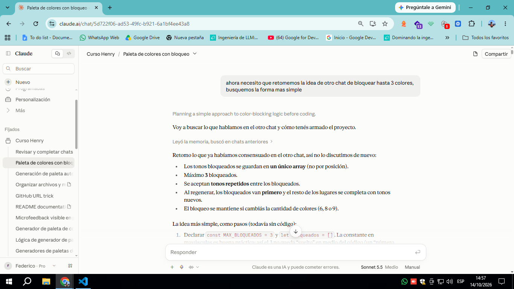
**R:** Se recuperaron las decisiones del otro chat: un único array de tonos (`bloqueados`), `MAX_BLOQUEADOS = 3`, tonos repetidos permitidos, bloqueados primero al regenerar. Se acordó un botón aparte (el click en la caja ya copia), el mismo toast de los otros avisos y que los bloqueados salten a la izquierda. Riesgo detectado: `innerHTML = ""` borra todo, así que el estado vive en una variable de JS y no en el HTML.

>**P:** Quiero que me guíes desde el principio para entenderlo y hacerlo yo, no que me armes todo.

**R:** Se pasó a modo guía: se explica el concepto en pasos chicos, escribís vos el código y yo lo reviso.

>**P:** Paso 1: variables de bloqueo. ¿Por qué algunas van en mayúscula? ¿Por qué VS Code las pone en distintos colores?

**R:** `const MAX_BLOQUEADOS` (valor fijo, mayúsculas, evita "números mágicos") y `let bloqueados = []` van arriba de todo, afuera del listener. Concepto clave: alcance (*scope*); si estuvieran adentro se recrearían en cada click. Los colores son resaltado de sintaxis (*syntax highlighting*) por tipo de elemento. Se sugirió coherencia de idioma en los nombres (`MAX_BLOCK` → `MAX_BLOQUEADOS`).

>**P:** Diseño del botón: un botón grande por color rompe la estética. Propuse un círculo con "Block", y después un candado con una leyenda en los controles.

**R:** 1ª: círculo de tamaño fijo con `border-radius: 50%`; 2ª: candado con `aria-label` y leyenda en HTML estático indicando el máximo de 3. Se usa `<button>` (accesible por teclado) y va afuera de la caja que copia, para que los clicks no se pisen (propagación de eventos, `stopPropagation`).

>**P:** ¿Cómo se desbloquea? ¿Y si el identificador es el texto del candado?

**R:** Se usa un solo botón que alterna (*toggle*) con `if / else if`. El estado se lee del botón (`classList.contains` o `textContent ===`), lo que evita problemas con tonos repetidos. Lo que se guarda en el array es el tono numérico (`tonoFinal`), no el texto HSL: el dato vive en JS y la pantalla solo lo refleja. Para sacar un solo elemento: `indexOf` + `splice(posición, 1)`; `filter` sacaría todos los repetidos.

>**P:** Candado abierto/cerrado simple, en blanco y negro, para usar como `textContent`.

**R:** Emojis 🔓/🔒. Con `\uFE0E` pegado al emoji (selector de variación de texto) se dibuja en monocromo y obedece a `color`; alternativa: `filter: grayscale(1)`. Se recomendó declarar `CANDADO_ABIERTO` y `CANDADO_CERRADO` como constantes para escribir el emoji en un solo lugar y evitar comparaciones que den `false` en silencio.

>**P:** El botón aparece en el inspector pero vacío, y el estilo no se aplica.

**R:** 1ª: causas posibles de botón vacío (`textContent` mal escrito, nombre de variable distinto) y uso de `console.log` para depurar; 2ª: el inspector mostraba `class=".btn-bloquear"`: el punto se coló dentro de `classList.add`. El punto solo va en selectores (CSS, `querySelector`); en `classList.add` va el nombre solo. También faltaba el punto en `.color{ flex: 1 }` del CSS.

>**P:** No logro centrar el botón.

**R:** 1ª: `align-self` y `justify-self` no hacen nada porque `.color` no es `flex` ni `grid`; `text-align` centra el contenido, no el botón. 2ª: el CSS seguía con `padding` y `border-radius: 25px`. Solución en `.btn-bloquear`: `display: block`, `margin: 0 auto`, `width` y `height` iguales, `border-radius: 50%`, `padding: 0`.

>**P:** Que el botón haga algo: el listener no andaba (varias vueltas).

**R:** 1ª: `else` sin su `}` del `if` externo (SyntaxError que rompe todo el archivo); 2ª: `TypeError: Cannot read properties of null (reading 'addEventListener')`, porque un `querySelector` buscaba el botón antes de crearlo (orden de ejecución); 3ª: una función afuera del `for` no sabe qué botón ni qué tono le corresponde, el listener va dentro del `for`, justo después de `createElement`; 4ª: `querySelector(".btn-bloquear")` devuelve siempre el primer botón (solo andaba el primero), se usa la variable `btnBloqueo`; 5ª: se limpiaron restos del código viejo (`{` suelta, `botonBloquear` fuera de alcance, `tempGuadar`/`tempGuardar`).

>**P:** Meter el tono en el array y marcar el color bloqueado.

**R:** Al bloquear: `bloqueados.push(tonoFinal)` y clase `borde-bloqueado` en `franjaColor` (`classList.add`). Al desbloquear: `indexOf(tonoFinal)` guardado en una variable y `splice(posición, 1)` para sacar uno solo. Advertencia: `indexOf` devuelve `-1` si no encuentra y `splice(-1, 1)` borraría el último elemento.

>**P:** Que al generar la paleta se conserven los bloqueados, con candado cerrado y borde.

**R:** 1ª: plan y trampas (orden de líneas dentro del `for`, candado de nacimiento idéntico al del listener, no tocar `bloqueados` al regenerar); 2ª: se dieron tres piezas cortas: `let tonoFinal` más `const estaBloqueado = i < bloqueados.length` con `tonoFinal = bloqueados[i]` arriba del `for`, y dos `if (estaBloqueado)` (uno para la clase del borde tras crear `franjaColor`, otro para el candado cerrado tras crear `btnBloqueo`); 3ª: la pieza 1 estaba bien, faltaban las piezas 2 y 3. Sin ellas, hacer click en un candado que nace "abierto" duplicaría el tono en el array.

**Capturas sugeridas como evidencia:** inspector con `class=".btn-bloquear"` (error del punto), consola con el `TypeError`, y la paleta con candados cerrados y borde tras regenerar.